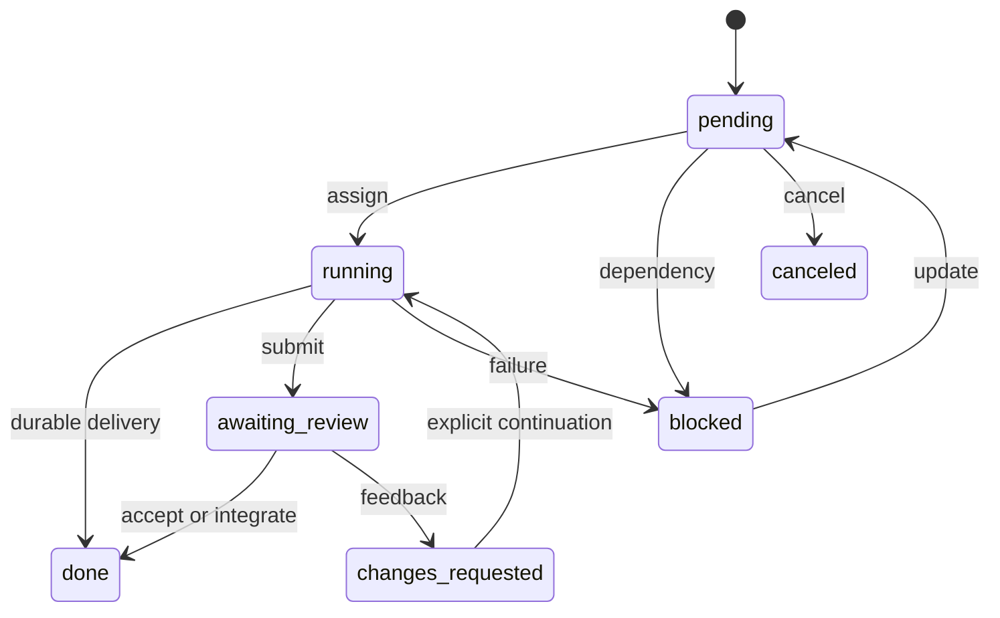
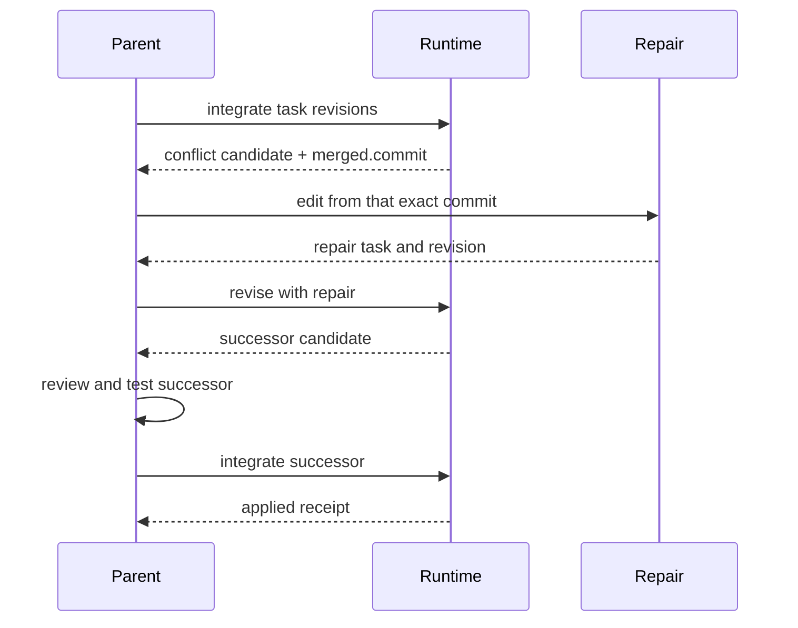
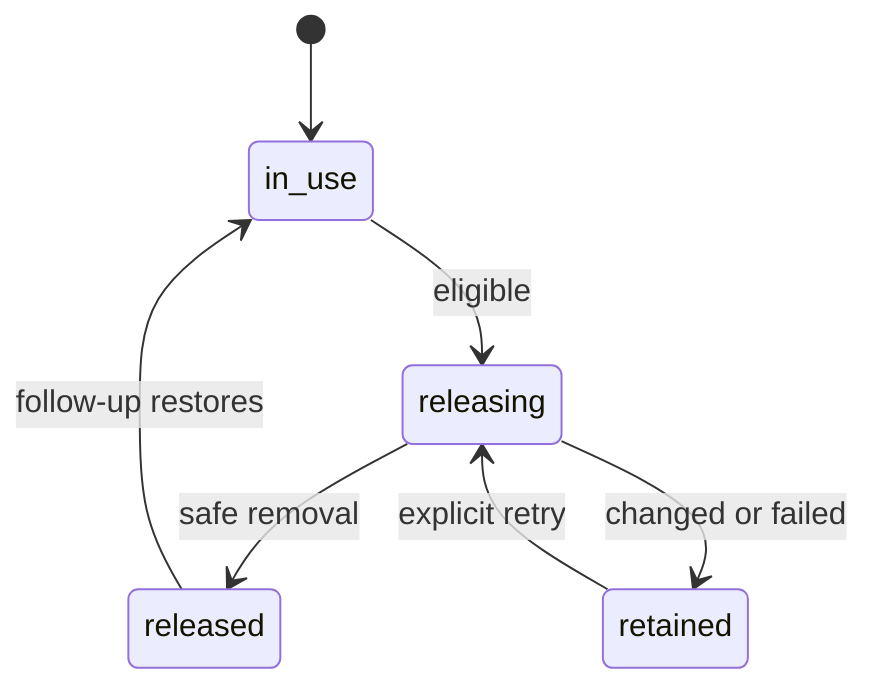

# Swarms and workflows

Delegate an independent assignment to an agent, or use JavaScript to coordinate
several assignments. Both use the same tasks, conversations, budgets, and isolated
workspaces. A parent and its direct children form one swarm; children do not
start nested swarms.

**Available now:** `/spawn`, `/workflow`, the Agents inspector, model tools, and
the Go runtime. **Currently disabled:** `/swarm` and all of its slash subcommands.
Examples below use the available interfaces.

## Contents

- [Start, wait, decide](#start-wait-decide)
- [Tasks, members, executions, and workspaces](#tasks-members-executions-and-workspaces)
- [Delivery and shared findings](#delivery-and-shared-findings)
- [Integrating editing results](#integrating-editing-results)
- [Workspace release and restoration](#workspace-release-and-restoration)
- [Follow-ups](#follow-ups)
- [Settlement and recovery](#settlement-and-recovery)
- [Inspecting saved work](#inspecting-saved-work)
- [Running JavaScript workflows](#running-javascript-workflows)
- [Examples](#examples)
- [Advanced task workflows](#advanced-task-workflows)

[Documentation index](README.md) · [Go and JavaScript API](API.md#swarms-and-workflows)

## Start, wait, decide

Use `/spawn [--read-only] [--review] <brief>`, or ask the model to delegate.
Give repository-relative paths and a bounded assignment.

Before model-driven coordination, `swarm_help()` supplies an embedded guide for
the caller's role: parents get the full coordination guide, while children get
messaging, waiting, shared-findings, and blocker guidance for their available tools.
Before writing a workflow, the parent-only `workflow_help()` supplies the JavaScript
API and examples. Both help tools are read-only and work outside this checkout.
Their instructions guide use; reading them is not a runtime permission gate.

| Work | Model-tool flow |
|---|---|
| Research | `spawn_agent({task_name, message, read_only:true})` → result delivery |
| Reviewed research | Add `review:true` → `swarm_review` the exact revision |
| Editing | `spawn_agent({task_name, message, read_only:false})` → validate → `swarm_integrate` |
| Scripted coordination | `workflow_run(...)` → foreground result or background notice |

Managed model spawns require an explicit boolean `read_only`; missing or malformed
values fail before allocation. They return immediately. Results arrive as work
progresses, so the parent can continue its own assignment.

`swarm_read` groups state into **Needs decision**, **Working**, and **Done**. Follow
the returned `action`/`next`; do not infer completion from an idle agent alone.
Use `wait_agent` when no independent work remains. It wakes for relevant updates
or cancellation and accepts a timeout from 10 seconds to one hour.

A wake is a notification, not a full status report. Read saved evidence through
`swarm_read`. A parked member releases its execution slot, registry, and session
lease after checkpointing; wakeup resumes the same execution and remaining allowance.
Unread publications visible to that execution also wake it: findings from its run
and host facts from any run. Publications do not restart idle or completed agents.

On the native backend, status counts and first pages use transactionally maintained
semantic facts. Parent waits compare canonical values against their original
baseline: deletion alone, label changes and A→B→A are not news. A running
workflow's controlled changes stay suppressed; ending control exposes a value
that still differs. Mail and this comparison share one durable read. News and
runtime idleness are independent and can both be reported on the same wake.

Waits use scoped notifications and recheck durable readiness after waking; a hint
never grants authority or acknowledges delivery. Native settlement and delivery
repair select current obligations and their dependencies. Legacy backends retain
correct full-family reads. Exact batch `next` actions still include all
candidate-ready references rather than silently truncating them. See
[semantic coordination reads](API.md#semantic-coordination-reads).

## Tasks, members, executions, and workspaces

| Object | Purpose |
|---|---|
| Task | Assignment, requirement, revision, result, and completion evidence |
| Member | Durable identity, conversation, model, tools, and filesystem authority |
| Execution | One logical turn with its generation, budget, outcome, and source |
| Workspace | Replaceable checkout and scratch; live read-only root outside Git |

Finishing an execution captures a result. A task completes only when its fixed
requirement is satisfied. Releasing a workspace frees files, not the member or
conversation.

| Requirement | Used for | Completion evidence |
|---|---|---|
| `delivered` | Ordinary research | Exact result saved to parent input or a workflow step |
| `reviewed` | Research with explicit review | Parent acceptance of the exact revision |
| `applied` | Editing | Confirmed integration, or immutable proof of unchanged output |

A negative finding can be a valid delivered result. Delivery confirms receipt,
not correctness. Failed executions leave unresolved tasks.



These are typical paths, not every permitted update. An accepted editing revision
can remain `awaiting_review` until integration succeeds. Dependencies need `done`;
a canceled dependency blocks dependents. Cycles, cross-run dependencies, and
stale revisions are refused. Owners report blockers with `swarm_block`. For a
workflow worker, this interrupts the entire attempt and returns control to the
parent after its active workers and host operations settle. Completed candidates,
unfinished edits, and scratch remain available; the parent decides how to recover.
Ordinary waits and blockers outside workflows retain their usual behavior.

## Delivery and shared findings

Completion identifies the exact task, revision, and execution. Results up to
16 KiB arrive inline; larger results include a 2 KiB preview and a retrieval
reference. Parent input admits at most 16 messages / 64 KiB per checkpoint and
leaves overflow queued. Input and delivery receipts save together.

Until that save, completed research can display `idle · delivering`. Inspector
reads do not record delivery, and receiving an artifact reference does not mean
the parent read all its bytes.

### Workflow results

Foreground `workflow_run` returns `{id, status, output, steps, next, error?}`.
Saving that result consumes its terminal notice atomically. Background starts
return an acknowledgment; terminal output arrives later. Failed saves leave the
notice recoverable.

An explicit worker blocker returns status `interrupted` with error code
`workflow_blocked`. The error's `session` identifies the worker; `result` contains
`task`, `execution`, `revision`, and `reason`. Inspect the report and retained
assignments before continuing. This interruption cannot be caught to resume the
JavaScript attempt; it does not automatically integrate, refresh, or retry work.

A successful `agent`/`followup` workflow step records delivery before JavaScript
receives its result. Failed steps do not. Workflow recovery can replace a lost
notice; a later script failure does not undo research already delivered to it.

### Messages and publications

| Tool | Effect |
|---|---|
| `send_message` | Deliver information at a safe boundary; never start an idle worker |
| `followup_task` | Steer active work or explicitly continue an idle member |
| `swarm_publish` | Share findings, existing artifacts, or selected local `files` |
| `read_artifact` | Read conversation artifacts or evidence explicitly published in the family |
| `restore_artifact` | Restore authorized artifact bytes to a new local file |

Final results need no separate publication unless handing off local files.
Publications preserve attribution, optional source/commit references, and
superseded versions, and carry a kind: a finding (the default) is about the
current work and reaches the other members of
its run; a host fact (`kind:"host"`: a command that hangs, a runtime that is
missing) also reaches the parent and the members of every later run. Each one
arrives as a digest in the reader's next peer-message admission (the author
excluded, the latest of a supersede chain only), introduced as verified
information to use rather than re-derive and committed with the same receipts as
mail; the full text is a `swarm_read` away by ID, which also lists who has read
it. Search is literal and case-insensitive. Other agents' private transcripts and
unpublished artifacts remain private; a guessed artifact ID grants nothing.

Matching keyed claims coalesce within their scope, run and captured commit.
Superseding withdraws only the author's named record, not other authors'
confirmations. A surviving confirmation can become the current representative;
`duplicateOf` keeps its historical link, while `confirmations` lists other
current supporting records. Corrections remain deliverable even when they now
agree with another claim. Promoted confirmations have exact delivery receipts
and can arrive once after the reader's cursor has passed their original posting
time; ordinary publications retain their watermark-based receipts.

Peer text is information, not user authorization. Review feedback alone does not
restart idle workers.

### Durable file handoff

Scratch is removed when a workspace is released. Every member with a scratch
also has an output directory inside it, exported to its commands as
`$POLLYTOOL_OUTPUT_DIR` (`$TMPDIR/output`). When the member completes, or
fails for good, the runtime captures every regular file there byte-for-byte as
an artifact of the member's session, pins the artifacts to the swarm, records them on the task
revision as `outputs` (and on the `AgentResult`), and empties the directory.
Each reference carries the file's slash-separated path relative to the
directory as `name`, its byte count and a content-derived ID. The completion
notice lists them; `swarm_read` shows them on the task. Capture happens before
the result exists, so nothing can release the scratch first, and a capture that
cannot be completed exactly (a symlink, more than 16 files, a file over 16 MiB,
more than 64 MiB in total, or a file whose size or modification time changes
while it is read) fails the completion with the reason instead of delivering a
partial or torn set. A failed attempt's captured outputs reach the parent with
the failure notice and stay on the blocked task. The directory is cleared only
after pinning and terminal-result persistence succeed; failed transactions,
pauses, cancellations, and follow-ups that make a final answer provisional leave
the originals available for continuation or retry. A resumed execution captures
the current files, including any corrections. Cleanup errors do not invalidate
an already durable result. The worker states the reproduction command and
prerequisites in its result:

```javascript
// Worker: write fixture.json and input.bin under $POLLYTOOL_OUTPUT_DIR, then
// complete with "command: <exact project-specific command>; prerequisites: ...".
// Parent: each outputs[].id names exact bytes; choose a new local destination.
restore_artifact({id: "sha256:...", path: "/parent/scratch/fixture.json"})
```

For files a teammate needs **before** the worker completes, or files outside the
output directory, `swarm_publish({files: [paths], scope: "workspace", text})`
captures them into a publication under the same limits. Paths are literal (no
`$TMPDIR` expansion), relative to the caller's working directory or absolute,
and must pass its read policy; each reference records the input path in `name`.
Capture preserves exact bytes, including binary data and line endings; it does
not capture directories or permissions. The publication and its artifact pins
commit together. A failed call publishes no partial handoff; privately stored
bytes from an earlier file in that call may remain in the author's session.
Capture is not tied to a language or toolchain.

`restore_artifact({id,path})` uses the same conversation/publication authorization
as `read_artifact`, checks the destination's write policy, and creates a new file
without overwriting existing files. The destination directory must already exist
and allow a temporary sibling file; restoration needs filesystem hard-link support.
It never executes the restored content.
Published bytes survive workspace and scratch cleanup, subject to session/family
artifact retention rather than a grace period. Small reproductions can instead
inline complete file contents and commands. Use `review:true` selectively when
verification needs the live workspace; do not rely on scratch paths after release.

Artifact hashes identify bytes, not trust. Inspect received files before any
execution. A worker's suggested reproduction command and results are evidence,
not new authorization. Choose verification appropriate to the project under the
parent's existing authorization and sandbox policy; never bypass a denial.
Restoring an artifact does not approve or run any suggested command.

## Integrating editing results

Pass exact editing task revisions:

```json
{"tasks":[{"task":"TASK_ID","revision":3}],"drift":"paths"}
```

`swarm_integrate` accepts and integrates them under one exclusive gate. Changed
work becomes `done` only after confirmed application. Unchanged submissions can
complete from immutable base/result proof without an empty apply. Mixed batches
are supported.

| Result | Meaning |
|---|---|
| `status:"applied"` | Changed work applied; returns candidate, tasks, and receipt |
| `status:"done"` with `unchanged` | No application needed for those tasks |
| `conflicts` | Candidate retained for an editing repair |
| `parent_changed` | Ready candidate needs explicit refresh |
| `recovery_required` | Observe the interrupted apply before choosing the next action |

To finish an existing candidate, pass `{"candidate":"CANDIDATE_ID"}` instead of
tasks. Use exactly one selector. Candidate retries keep the original drift policy;
do not pass a new `drift` with a candidate.

### Repair and validation



A repair is a distinct editing task based on `candidate.merged.commit`. `revise`
records its contribution and merges remaining inputs. `refresh` updates a ready
candidate against parent changes; it does not resolve conflicts. If refresh
changes the candidate, review and test the successor. Unchanged refreshes keep
the candidate ID and acceptance.

Use [integrate-results.js](../examples/workflows/integrate-results.js) for bounded
repair, review, checks, and integration. It defaults to two repair executions and
one refresh. Supply check commands explicitly; an empty list skips checks.
Each check gets a separate writable copy of the immutable candidate.

**Workflow `exec` enables `pipefail`, but not `errexit`.** A later command can still
hide an earlier failure. Keep required commands in separate awaited calls, or
propagate failures explicitly. Only ordinary command failures and negative verdicts
enter repair; sandbox failures, cancellation, exhausted budgets, and uncertain
applies stop it.

Check-side edits are not contributions. Adopt intended changes through an editing
task, revise, and validate again. Dirty validation copies are retained for inspection.

### Drift and receipts

`paths` checks changed paths, rename endpoints, existence, types, modes, contents,
and real-directory ancestors, including ignored destinations. Unrelated parent
edits survive, so the final checkout can differ from the tested snapshot. `tree`
also requires whole-parent-tree equality. Both preserve parent HEAD, branch, and index.

Every public candidate has `receipt`. `null` means no recorded apply attempt for
that candidate; it says nothing about current parent contents. Receipt statuses
are `applying`, `applied`, `not_applied`, and `recovery_required`.
`polly.integrate` returns apply evidence in `result.receipt`; unchanged work may
have no apply receipt.

After the write boundary, cancellation waits for the bounded apply and receipt;
it does not roll files back. Parent lease loss still fences writes. The default
apply bound is two minutes (`--swarm-apply-timeout`), with a separate ten-second
receipt bound.

Reconciliation compares observed files with before/after states. A matching after
state confirms application; a matching before state permits an explicit retry;
mixed state requires recovery. There is no automatic patch replay. Applied retries
return the original receipt, even after snapshot refs are forgotten.

Integration ends at working files. Staging, commits, and publishing require their
own task authorization. See the [integration API](API.md#integration).

## Workspace release and restoration

Git-backed members, including researchers, use isolated snapshots. `source` selects
a checkout in the same repository, not a package working directory. Explicit
`commit` selects that exact full Git ID and history. Omission captures eligible
current files into a parentless commit; supply an original commit for history work.
Non-Git research uses its saved live root. Failed Git setup never falls back to it.

Editing requires Git 2.40+ and a registry configured for supported sandboxing or
explicit unsandboxed execution. Native tools, MCP, skills, and instructions bind
to the assigned root. Members have private scratch and cannot see parent/sibling
workspaces; approved Git history/configuration stay readable.
[Snapshot and sandbox limits](SANDBOX.md#swarm-snapshot-limits).

### Per-agent model and sandbox

Both `spawn_agent` and workflow agents accept an optional `model` (`provider/model`)
and upstream route (`model_host` in the tool, `modelHost` in JavaScript). Omit them
to inherit the parent's route. An explicit model does not change the parent.

The optional `sandbox` preset enables or tightens sandboxing for that child,
including when the parent is unsandboxed:

```js
const review = await polly.research("Parser review", "Review the parser", {
  model: "provider/model",
  sandbox: "workspace+private-home",
});
```

`--agent-sandbox` / `POLLYTOOL_AGENT_SANDBOX` supplies a mandatory child default.
Per-agent policies may only narrow that policy and existing parent restrictions;
they cannot disable sandboxing. Without either option, inheritance is unchanged.
The model route and sandbox restrictions are retained on continuation and refresh.
See [child-only sandbox policies](SANDBOX.md#child-only-sandbox-policies).

### Automatic and explicit release

A workspace becomes eligible when its tasks are done/canceled, nothing is active
or paused, no workflow reserves it, and no uncertain apply involves it. Deletion
also needs proof that its contents match the base or completed editing result.
Unexpected edits or cleanup failure retain it with a reason; task completion stays.

Use `swarm_control({action:"release", id:contextID})` for one eligible context.
Find the context through `list_agents({details:true})`. Results are `released`,
`ineligible`, `retained`, or `busy`; unsuccessful release includes a reason.
A known already-released member workspace returns `released` again.

Inside a workflow, `polly.release(context)` can free its own idle validation copies
or settled member workspaces while preserving reservations and conversations.
The default capacity is 512 workspace slots, including validation copies.
Set it with `--swarm-worktrees` / `POLLYTOOL_SWARM_WORKTREES` or the Go host's
`swarm.Config.MaxWorktrees`; zero keeps the default, and negatives are rejected.
This process-level capacity is distinct from concurrent execution slots and the
saved run's logical-start budget. Parked, paused, recoverable, or review-held
workspaces still consume capacity until safely released.



This diagram describes resource lifetime. Only `releasing` and `retained` are
stored release states; successful release removes the context record. Interrupted
release is rechecked on reopen. Shutdown joins cleanup workers.

### Disposable checks and retained evidence

`polly.context({commit, disposable:true})` creates a check-only copy that may be
removed regardless of generated output. It cannot be snapshotted, seed another
copy/agent, or become a contribution. Ordinary copies require safe-content proof.

The retained Go client APIs provide family cleanup, discard, and forgetting;
the corresponding `/swarm` slash commands are currently unavailable. Discard is a
user/client operation, not a model or workflow tool.

Workspace release preserves snapshot refs and task/execution provenance. Parent
record expiry/deletion does not itself remove Git workspaces or refs. Forgetting
requires safe cleanup and resolved integration obligations and removes default
restoration sources for future follow-ups.

## Follow-ups

```js
followup_task({
  target: "parser_tests",
  message: "Check the implementation now in the parent files.",
  refresh: true,
})
```

Without refresh, continuation preserves the member's source. Active work is steered
within its execution; interrupted work keeps its remaining allowance. Changes
requested or unaccepted submissions reopen the task at a new revision. A settled
assignment gets a linked new task. A follow-up that starts an idle member, and a
refresh, put their text into the member's task brief with the launch provenance;
only steering an active or paused execution delivers it as a peer message at the
next input boundary.

`refresh:true` requires an idle member whose assignment is done. It captures
current parent files and replaces only a safe workspace. It keeps identity,
conversation, role, model, tools, sandbox restrictions, and requirement. Parent
edits after capture are not included. The worker's scratch is carried into the
new workspace (the brief says so, or says it was lost); non-Git research retains
its original live source.

Active/paused work, open assignments, workflow reservations, retained edits, and
uncertain integration block refresh. Refresh does not accept old work or grant a
budget. Use a new worker for independent review.

The result identifies member, durable message ID, operation (`steer`, `resume`,
`new_task`), task, execution, and baseline origin. Reusing the same call ID reuses
its recorded assignment/capture; changed arguments are refused.

### JavaScript follow-up

`polly.followup` takes a completed task ID and creates a linked task on the same
member. Research defaults to the original base commit; editing defaults to the
completed result commit. An explicit `commit` selects another retained/source
commit. Missing provenance returns `workspace_unavailable`, never current parent
files as an implicit replacement.

```js
const first = await polly.agent({
  label: "Inspect parser", task: "Inspect the parser", readOnly: true,
});
const detail = await polly.followup({
  task: first.task, question: "Explain the edge case against the same source",
});
```

For unresolved reviewed work, record feedback with `swarm_review` and continue
explicitly. A workflow may use `polly.agent({session, task: feedback})` for its
reserved member; feedback alone does not wake it. A workflow may also continue
its own member whose last execution failed, for example a typed result refused
after its corrections: `polly.agent({session, task})` keeps the conversation and
workspace, inherits the result schema unless the call supplies one, starts a new
execution with fresh corrections, and spends a start, so a script that retries
without limit is bounded only by the run's starts. A paused member (iteration
budget, interrupt, shutdown), a stopped member, and another workflow's member are
still refused, and a refusal carries no `session`: keep the id from the earlier
failure.

## Settlement and recovery

Parent answers remain provisional until delivery, review, integration, replies,
failures, and budgets settle. The harness supplies concrete next actions and allows
one corrective prompt for unchanged unresolved state before returning a blocker.
Display folding never removes an obligation.

Inspect a failed/interrupted workflow, then acknowledge it:

```js
swarm_control({action: "acknowledge_workflow", id: reportID})
```

To retain unresolved work explicitly, add `defer:true` and a nonblank `note` after
reporting the failure. Deferral records exact unresolved revisions; it does not
accept, apply, or cancel them. Later changes invalidate that deferral. Completed
workflow reports are acknowledged through delivery and need no manual call.

Leases and execution generations fence writes. Checkpoints save output and delivery
receipts together. Uncertain tool intents become interrupted receipts, not
reexecution. Shutdown pauses unfinished members and interrupts workflows.
JavaScript has no persisted heap: a workflow restart is a new attempt.

Cold recovery validates saved history before changing it, then repairs independent
obligations in leased record transactions. If a later group fails, construction
fails; reopening resumes from durable predicates without replaying tools, patches
or JavaScript. Workspace release and destructive scratch pruning wait until
initialization succeeds. Release still requires a committed mark, owned-file
proof and a committed removal receipt; uncertain storage errors never authorize
filesystem deletion.

Starts default to 256 per run; concurrent children default to 32. Additional starts
and iteration allowances require user-directed client grants, not model tools or
scripts. Resuming a paused execution preserves its remaining allowance; starting
a new turn spends another start. Resuming an agent does not resume JavaScript.

Exhausted transient model-call recovery leaves a **retry pause** only after
its checkpoint is saved. The pause retains the provider reason, attempt count,
and earliest eligible retry time with the execution and its accepted transcript.
`followup_task` or an explicit host resume continues that same execution after
the cooldown; it neither spends a new start nor grants more iterations. A
storage failure is not reported as a confirmed recoverable retry pause.
Incoming mail, publications, reopening, and scheduler wakeups do not restart
retry-paused work automatically. A workflow receives the paused worker's
session/result receipt; resuming the worker does not replay JavaScript.

Root sessions retain the same recovery information without requiring a delegated
worker. Reopen the session and explicitly ask to continue from saved history;
Polly does not resubmit the original prompt or replay uncertain tool effects.

A user's **Stop agent** persists across restarts. A parent
`followup_task`, including a refresh, cannot clear it; the user must choose
**Resume agent**. Model `interrupt_agent` remains a temporary
interruption that a parent follow-up can resume.

One-shot memory sessions promote to disk before shared coordination mutates state.
Library hosts must provide durable storage for recovery. Coordination records
require swarm format 2, independently of the SQLite schema. Incompatible roots
are refused without altering their saved records or files.

## Inspecting saved work

Use the Agents inspector for conversations and approvals. Model reads are bounded:

| Read | Selection |
|---|---|
| `swarm_read` | Status; `section:"decisions"` or `"working"` pages a bucket |
| Tasks | `view:"tasks", id`, then `section:"details"` or `"result"` |
| Workflows | `view:"workflows", id`; select `steps`, `step`, `source`, `input`, or `output` |
| Messages | `view:"messages"`; select an addressed message by ID |
| Publications | `view:"publications", query` (literal, case-insensitive, or an ID) or `id`; `kind` keeps host facts or findings |
| Workers | `list_agents({path_prefix?})`; `details:true` adds provenance, budgets, and context |

Lists use 1-based offsets, default limit 50, maximum 100, and a 16 KiB response
budget. Pass returned `next` as the next `offset`. Large selections return previews
and artifact references for paging/search. Reads neither acknowledge delivery nor
resume execution. Captured evidence is separate from current workspace contents.

## Running JavaScript workflows

```text
/workflow /absolute/path/workflow.js /absolute/path/input.json
```

The slash command reads files. The model's `workflow_run` takes JSON-encoded string
`input` plus exactly one source form:

| Source form | Use |
|---|---|
| `source` | JavaScript text, never a filename |
| `skill` and `path` | A shipped skill script, read by the host under its catalog/read policy |

Use the skill form for shipped scripts so the model does not rewrite their bytes.
Path-like `source` is rejected before execution. Foreground is the default;
`background:true` returns a report ID and later terminal notice. Both record source,
input, host operations, results, and output. `swarm_control` can cancel a workflow.

```js
const {obj, str} = polly.schema;
polly.workflow("research", obj({question: str()}), async ({question}) => {
  const result = await polly.research("Research question", question, {
    schema: obj({answer: str()}),
  });
  return result.value;
});
```

`polly.defineWorkflow({name, inputSchema, run})` is the object form. New agents need
a purpose `label` of 1–80 characters; continuations preserve it and the saved title.

### Execution rules

- Await every host operation. Returning with pending effects or an unresolvable
  promise fails the attempt; output serialization cannot start effects.
- `parallel` preserves order, defaults to concurrency 8 and `errors:"collect"`,
  and accepts 1–256 workers. `throw_after_all` waits for every branch before failing.
- Input/output schemas validate at boundaries. Objects reject extra keys by default;
  `keyed` preserves the original ID set and rejects duplicates before dispatch.
- Typed tool-enabled agents finish through exclusive `swarm_complete({value})`. A
  `value` sent as a JSON string is decoded once and accepted if the decoded value
  validates. Invalid/missing output gets at most three corrective continuations
  within the same budget; each correction quotes a bounded error, names the
  schema's spelling of a mis-cased key, and says how many remain. Tool-free
  agents return validated JSON.
- `exec(command, {check:false})` recovers ordinary nonzero exits only after process
  startup and complete capture. Approval, sandbox setup, timeout, cancellation, and
  incomplete capture still reject. Stderr text does not classify errors.
- There are no Node.js/module/process/filesystem/network/timer APIs. Host tools
  enforce authority. `polly.scope({context}, ...)` binds work, not a new `cwd` grant.
- Defaults are five seconds per uninterrupted JS slice, 4,096 host calls, and a
  512-frame stack. Host waiting does not spend the slice budget. There is no hard
  heap quota. Scripts cannot raise agent iteration limits.

Missing provider usage is `null`, not zero. See the
[JavaScript API](API.md#javascript-api) for operations and return shapes.

### Recording from a Go host

A host may implement `workflow.DeltaRecorder` alongside or instead of the existing
`Recorder`. The runner prefers `SaveWorkflowDelta(ctx, ReportDelta)` when present.
Each delta owns a JSON-cloned, steps-free `ReportHeader`, replacements indexed by
zero-based step position, and `TotalSteps`. The recorder must validate numeric
indexes, nondecreasing totals and gap-free reconstruction, and atomically save the
header and replacements. Coordinator-owned run/acknowledgement fields remain the
coordinator's responsibility. A host implementing only `Recorder` still receives
full reports. The returned final `Report` remains complete; the VM and final report
still retain history even when individual saves avoid cloning it all.

The native swarm runtime implements delta recording on its supplied coordination
backend. With SQLite, a steady-state save reads the header and selected step
records, checks the indexed step count and final numeric key, and writes only
changed records. Step-delivery receipts and the terminal parent notification share
that transaction. Header comparisons and receipt-only task updates preserve exact
JSON number tokens. `SaveWorkflow` remains available for full reports, including
explicit truncation; deltas cannot shrink history or leave gaps.

This bounds checkpoint persistence, not the whole workflow lifecycle. A selected
header or step can itself be large. Terminal processing visits the workflow's
actual agent/task dependencies, and controller teardown visits the workflow's
owned members. Cold preparation and automatic workspace release still have broader
coordination costs. Backends without native record access remain authoritative
through the correct, whole-family compatibility adapter. No schema or runtime-capacity
change is needed for delta recording.

Pre-effect intent saves remain synchronous. A save error can represent an
uncertain commit: it is not permission to retry the host effect. Cancellation
still drains completed receipts before recording the terminal result and closing
bindings. Delta recording does not alter the JavaScript 8-default/256-maximum
branch limit or the runtime's separately configured execution capacity.

Workflow tool bindings are reserved per context and current scope/policy. An
unrelated context need not wait for another context's tool construction. Owned
construction and close work run outside the shared binding-map lock; custom
constructors and closers can still block their own operation. A parked execution
must reacquire a fresh authorized binding rather than retain a workspace-bound
registry for reuse elsewhere.

## Examples

| Script | Purpose |
|---|---|
| [integrate-results.js](../examples/workflows/integrate-results.js) | Repair, review, check, and integrate exact editing results |
| [integration-evidence-exercise.js](../examples/workflows/integration-evidence-exercise.js) | Exercise conflict repair and fresh validation in a disposable Git fixture |
| [fix-review-findings.js](../examples/workflows/fix-review-findings.js) | Isolated fixes, independent review/checks, and bounded repair |
| [doc-drift-audit.js](../examples/workflows/doc-drift-audit.js) | Verify claims against code, optionally edit, and recheck the original claims |
| [code-review.js](../examples/workflows/code-review.js) | Independent reviews, canonical issue judging, then an audit of the judgments |
| [task-dependencies.js](../examples/workflows/task-dependencies.js) | Dependencies, feedback, reassignment, and reviewed acceptance |
| [reconcile-integration.js](../examples/workflows/reconcile-integration.js) | Observe an interrupted apply without replaying it |

[input.json](../examples/workflows/input.json) is a fix/review input template.
The integration exercise expects tracked `features.txt` containing `features=base`
plus a newline and input `{"path":"features.txt"}`; it changes fixture working files.
The reconciliation example takes `{"id":"candidate-or-apply-id"}`.

## Advanced task workflows

The coordination surface has 14 parent tools and six child tools; typed children
add `swarm_complete`.

`polly.tasks.create` fixes a requirement at creation. An owner supplies its
compatible default; an unowned task defaults to `delivered`. Use `applied` for
unowned editing work. Assignment rejects mismatched authority. Change an obligation
by creating a replacement task and explicitly updating dependents.

Use `polly.tasks.update` for dependencies/assignment, then
`polly.agent({taskID, label, task: brief, readOnly:true})` once dependencies complete.
Submission and capture are automatic. `swarm_block` leaves the assignment unresolved.

Full method and record references: [Go API](API.md#swarms-and-workflows).
